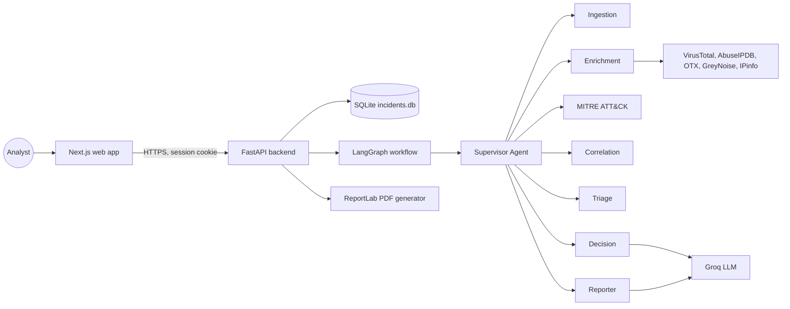
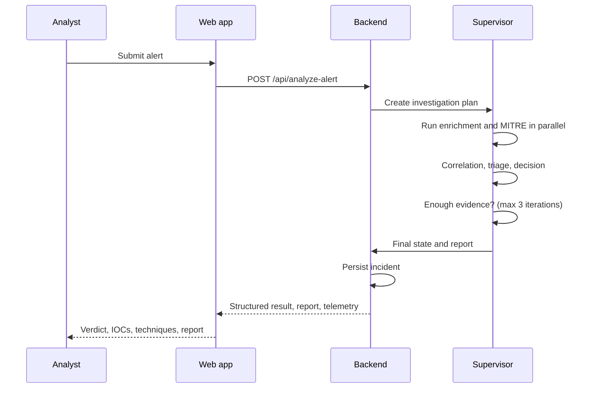

# አውራ AI

Autonomous multi-agent Security Operations Center (SOC) platform.

## Overview

አውራ AI investigates security alerts with a supervisor-controlled team of specialist AI agents. An analyst pastes or uploads a raw alert, and the platform extracts indicators of compromise (IOCs), enriches them with threat intelligence, maps observed behaviour to MITRE ATT&CK, scores risk, reaches a verdict and produces a written investigation report, which can be exported as a PDF. Every investigation is stored as an incident and surfaced on a dashboard with volume charts, an ATT&CK matrix, agent health and an audit trail.

The platform consists of a Next.js 14 web application and a FastAPI backend that orchestrates the agents with LangGraph.

## Problem statement

SOC analysts receive far more alerts than they can investigate by hand. Each alert requires the same repetitive steps: pulling out IOCs, checking them against several threat-intelligence sources, working out which attacker techniques are involved, deciding how serious it is and writing it up. አውራ AI automates this triage loop so that analysts spend their time on decisions rather than on data gathering, while keeping every step of the reasoning visible and auditable.

## Key features

- Supervisor-controlled investigation: a Supervisor Agent plans which specialist agents run, executes independent agents in parallel and decides when enough evidence has been gathered (bounded to three iterations).
- Specialist agents for ingestion, enrichment, MITRE ATT&CK mapping, correlation, triage, decision and reporting.
- Threat-intelligence enrichment through VirusTotal, AbuseIPDB, AlienVault OTX, GreyNoise and IPinfo, with a demo gateway when no keys are configured.
- Investigation studio with a code editor for raw alerts, a live agent trace and tabs for IOCs, techniques and the final report.
- Incident list and incident detail pages with status workflow (open, acknowledged, escalated, closed) and analyst feedback.
- Dashboard with incident volume, severity breakdown, MITRE ATT&CK matrix and per-agent health metrics.
- PDF export of any investigation report.
- Session-based authentication with bcrypt password hashing, account lockout, login rate limiting and an admin-only user management screen.

## System architecture

The web application talks only to the FastAPI backend. In development Next.js proxies `/api/*` to the backend; in production the two services run as separate containers. The backend stores incidents in SQLite and runs the LangGraph workflow in-process. Large-language-model calls go to Groq; threat-intelligence lookups go to the external providers listed above.

### Architecture diagram



### Investigation flow



## Technology stack

| Layer | Technology |
|---|---|
| Web application | Next.js 14 (App Router), React 18, TypeScript 5, CSS Modules, Framer Motion, Recharts, Lucide icons, Monaco editor |
| Backend API | Python 3.11, FastAPI, Uvicorn, Pydantic v2 |
| Agent orchestration | LangGraph, LangChain, Groq (default model `openai/gpt-oss-120b`) |
| Retrieval | Qdrant vector store, Google embeddings (optional) |
| Persistence | SQLite |
| Reporting | ReportLab |
| Authentication | PyJWT (HS256 session tokens), bcrypt |
| Testing | pytest, pytest-cov, FastAPI TestClient, pypdf |
| Packaging | Docker, Docker Compose, GitHub Actions |

## Directory structure

```
.
├── app/                      # Next.js application (App Router)
│   ├── agents/               # Agent overview page
│   ├── analyze/              # Investigation studio (analyze, MITRE and forensics tabs)
│   ├── audit/                # Audit log
│   ├── components/           # Shared UI: shell, header, sidebar, badges, error boundary
│   ├── dashboard/            # Main dashboard
│   ├── forensics/, mitre/    # Redirects into the investigation studio tabs
│   ├── incidents/            # Incident list and incident detail ([id])
│   ├── lib/                  # API client (api.ts) and i18n
│   ├── login/                # Sign-in page
│   ├── settings/, users/     # Settings and admin user management
│   └── threat-intel/         # Threat-intelligence sources
├── backend/
│   ├── agents/               # Supervisor and specialist agents
│   ├── api/main.py           # FastAPI application and routes
│   ├── config/settings.py    # Settings loaded from the environment and .env
│   ├── data/                 # MITRE ATT&CK data, synthetic alerts, sample policies
│   ├── db.py                 # SQLite persistence
│   ├── evals/                # Evaluation cases for the agents
│   ├── gateways/             # Threat-intelligence integrations
│   ├── graph/                # LangGraph workflows (v1 linear, v2 supervisor)
│   ├── middleware/           # Authentication, rate limiting, security headers
│   ├── rag/                  # Vector store ingestion and retrieval
│   ├── reporting/            # PDF generation
│   ├── schemas/              # Pydantic models shared by all agents
│   └── tests/                # pytest suite
├── api/index.py              # Vercel entry point that re-exports the FastAPI app
├── middleware.ts             # Next.js route guard (verifies the session cookie)
├── Dockerfile                # Web application image
├── backend/Dockerfile        # Backend image
├── docker-compose.yml        # Local two-service deployment
└── .github/workflows/ci.yml  # Type-check, build and backend tests
```

## Prerequisites

- Node.js 18 or newer
- Python 3.11 or newer
- A Groq API key
- Optional: VirusTotal, AbuseIPDB and AlienVault OTX API keys for live enrichment

## Installation

```bash
git clone <repository-url>
cd <repository-directory>
cp .env.example .env
```

Install the backend:

```bash
cd backend
python -m venv venv
venv\Scripts\activate        # Windows
# source venv/bin/activate   # macOS and Linux
pip install -r requirements.txt
```

Install the web application from the repository root:

```bash
npm install
```

## Environment variables

All variables live in `.env` at the repository root. The backend reads it directly; Next.js reads it for `middleware.ts`. Never commit `.env`.

| Variable | Required | Purpose |
|---|---|---|
| `GROQ_API_KEY` | Yes | LLM access for the reasoning agents |
| `AWRA_JWT_SECRET` | Yes | Signs session cookies. At least 32 characters. Must be identical for backend and web app |
| `ADMIN_EMAIL`, `ADMIN_PASSWORD` | Yes for first sign-in | Bootstrap administrator account. Created only when the password is set |
| `ANALYST_EMAIL`, `ANALYST_PASSWORD` | No | Bootstrap analyst account. Created only when the password is set |
| `AWRA_API_KEY` | No | Bearer key for service-to-service calls to the API |
| `COOKIE_SECURE` | No | Set to `true` behind HTTPS so cookies are only sent over TLS |
| `GOOGLE_API_KEY` | No | Embeddings for the retrieval pipeline |
| `VT_API_KEY`, `ABUSEIPDB_API_KEY`, `OTX_API_KEY` | No | Live threat-intelligence enrichment; the demo gateway is used when empty |
| `NEXT_PUBLIC_API_URL` | No | Backend base URL when the web app is not proxying `/api` |

Generate a signing secret:

```bash
python -c "import secrets; print(secrets.token_urlsafe(48))"
```

## Configuration

- Backend settings are defined in `backend/config/settings.py` and can be overridden by environment variables of the same name (for example `LLM_MODEL`).
- The development proxy from `/api/*` to `http://127.0.0.1:8000` is configured in `next.config.js` and only applies when `NODE_ENV=development`.
- Session lifetime is 8 hours, or 30 days when "Remember me" is selected. Accounts lock for 15 minutes after 5 failed sign-ins, and each IP address is limited to 10 sign-in attempts per minute.

## Usage

Start the backend:

```bash
cd backend && uvicorn api.main:app --reload --port 8000
```

Start the web application in a second terminal:

```bash
npm run dev
```

Open `http://localhost:3000`, sign in with the administrator account from `.env`, and open Investigations to submit an alert. Interactive API documentation is available at `http://localhost:8000/docs` while the backend is running.

To exercise the workflow without the web application:

```bash
cd backend && python test_workflow_v2.py
```

## API documentation

All routes are prefixed with `/api`. Unless noted, a route requires either a valid session cookie (set by `/auth/login`) or an `Authorization: Bearer <AWRA_API_KEY>` header. The OpenAPI document is served at `/docs` and `/openapi.json`.

| Method | Path | Description | Access |
|---|---|---|---|
| POST | `/auth/login` | Sign in and receive an httpOnly session cookie | Public, rate limited |
| POST | `/auth/logout` | Clear the session cookie | Public |
| GET | `/auth/me` | Current user | Session |
| GET | `/users` | List users | Admin |
| POST | `/users` | Create a user | Admin |
| PATCH | `/users/{id}` | Change a user's role | Admin |
| DELETE | `/users/{id}` | Delete a user | Admin |
| POST | `/analyze-alert` | Run a full investigation on a raw alert | Session or key |
| GET | `/incidents` | List incidents | Session or key |
| GET | `/incidents/volume?range=24h\|7d` | Incident counts per bucket | Session or key |
| GET | `/incidents/{id}` | Incident detail | Session or key |
| PATCH | `/incidents/{id}/status` | Update incident status | Session or key |
| GET | `/incidents/{id}/report.pdf` | Download the incident report as PDF | Session or key |
| POST | `/reports/pdf` | Generate a PDF from an ad-hoc investigation payload | Session or key |
| POST | `/feedback/{id}` | Record analyst feedback on a verdict | Session or key |
| GET | `/stats` | Dashboard statistics | Session or key |
| GET | `/mitre-heatmap` | Technique hit counts across incidents | Session or key |
| GET | `/agents/health` | Per-agent latency and last-run metrics | Session or key |
| GET | `/health` | Liveness check | Public |

Example investigation request:

```bash
curl -X POST http://localhost:8000/api/analyze-alert \
  -H "Authorization: Bearer $AWRA_API_KEY" \
  -H "Content-Type: application/json" \
  -d '{"alert": "Multiple failed SSH logins from 198.51.100.44 followed by a successful root login"}'
```

## Database architecture

Incidents are stored in a single SQLite database, `backend/incidents.db` (or `/tmp/incidents.db` on Vercel). The `incidents` table holds one row per investigation: `id` (primary key), `status`, `created_at` and `data`, which contains the complete `IncidentState` serialised as JSON. The schema therefore evolves with the Pydantic model rather than through migrations. Threat-intelligence responses are cached in `backend/ioc_cache.db`. Users and API keys are held in memory and seeded from the environment on startup; they are not persisted between restarts.

## Testing

Backend tests run with pytest from the `backend` directory. Coverage reporting is enabled in `pytest.ini`.

```bash
cd backend && python -m pytest tests
```

Use `--no-cov` for a faster run. The suite covers the API routes, authentication and lockout behaviour, the security middleware, dashboard aggregation and PDF generation; test credentials are supplied by `tests/conftest.py`, so no `.env` is needed.

Type-check the web application from the repository root:

```bash
npx tsc --noEmit -p .
```

The GitHub Actions workflow in `.github/workflows/ci.yml` runs the type-check, the production build and the backend tests on every push and pull request.

## Deployment

### Docker Compose

```bash
docker compose up --build
```

This starts the backend on `http://localhost:8000` and the web application on `http://localhost:3001`. Compose reads `.env` from the repository root; `AWRA_JWT_SECRET` is passed to both containers.

### Vercel

`vercel.json` routes `/api/*` to `api/index.py`, which exposes the FastAPI application as a serverless function, and the web application is built as a standard Next.js project. Configure the same environment variables in the Vercel project settings. Note that SQLite on Vercel is ephemeral, so incidents do not persist between deployments.

## Security considerations

- Passwords are hashed with bcrypt. No credentials are hardcoded; bootstrap accounts exist only when their passwords are configured.
- Sessions are HS256 JWTs in an httpOnly, `SameSite=Lax` cookie. The signing secret is never defaulted; without `AWRA_JWT_SECRET` the backend uses a random per-process secret and the web app rejects all sessions.
- Every data route requires authentication. The browser never carries an API key; `NEXT_PUBLIC_*` variables are bundled into client code and must not hold secrets.
- Alert input is sanitised and length-limited, requests are size-limited and rate-limited, and security headers are set by middleware.
- Set `COOKIE_SECURE=true` and serve over HTTPS in production.
- Rotate any API key that has ever been committed to version control.

Known limitations: the user and API-key stores are in memory, so users created in the admin screen are lost on restart; there is no CSRF token (the `SameSite=Lax` cookie mitigates but does not eliminate the risk for state-changing requests).

## Troubleshooting

| Symptom | Cause and fix |
|---|---|
| Sign-in succeeds but the app returns to the login page | `AWRA_JWT_SECRET` is missing or differs between backend and web app. Set it in `.env` and restart both |
| "Email or password is incorrect" for the administrator | `ADMIN_PASSWORD` is not set, so the account was not created. Check the backend log on startup |
| API calls return 401 | The session expired or the request has no cookie or bearer key |
| `No module named pytest` | Install the backend requirements into the interpreter you are using |
| Enrichment results are marked as demo data | No threat-intelligence keys are configured; the demo gateway is in use |
| Port 8000 or 3000 already in use | Stop the other process or change the port in the start command and `next.config.js` |

## Roadmap

- Persist users and API keys in the database.
- Threat-hunting, digital-forensics, response and reviewer agents.
- PostgreSQL with pgvector for investigation memory.
- Real-time updates over WebSockets.
- OpenTelemetry tracing and LLM cost tracking.

## Contributing

1. Create a branch from `main`.
2. Make the change with tests. Backend tests live in `backend/tests`; run them and the type-check before opening a pull request.
3. Keep this README accurate when behaviour, configuration or endpoints change.

## License

No license has been declared for this repository. Add a `LICENSE` file before distributing.
